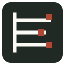
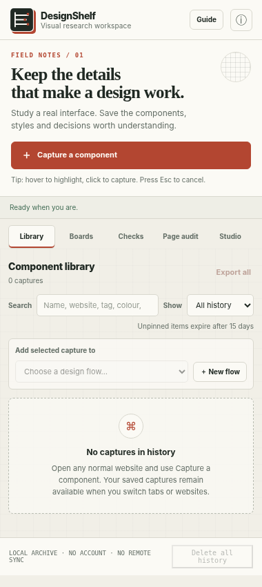

# DesignShelf

<p align="center">
  
</p>

<h3 align="center">Collect the details behind the interfaces you like.</h3>

<p align="center">
  A local-first browser extension for capturing, studying and organising real UI components.
</p>

<p align="center">
  
  
  
  
  
</p>

<p align="center">
  <a href="#what-you-can-do">Features</a> ·
  <a href="https://abduays.github.io/DesignShelf/">Live demo</a> ·
  <a href="#screenshots">Screenshots</a> ·
  <a href="#get-started">Get started</a> ·
  <a href="#privacy-and-permissions">Privacy</a> ·
  <a href="#development">Development</a>
</p>

---

DesignShelf is for the moments when you find a useful interface and want to understand how it is put together. Pick a section on a page, save a local snapshot, inspect its structure and styles, then organise it with the other examples you have collected.

It is a practical reference shelf for frontend developers, designers and people building design systems. It captures what the browser can observe; it does not claim to recover a website's original source project.

## Live demo

Try the [interactive DesignShelf demo](https://abduays.github.io/DesignShelf/) to explore the sample library, component inspector, design boards and token shelf. It uses fictional sample data and does not connect to your browser tabs. Install the extension to capture and inspect real websites.

## Screenshots

<p align="center">
  
</p>
<p align="center"><sub>DesignShelf's Field Notes workspace. The interface uses a paper, ink and oxide-red palette.</sub></p>

## What you can do

| Tool | What it is useful for |
|---|---|
| **Capture** | Pick a visible section and save its rendered markup, component tree, dimensions and selected computed styles. |
| **Inspect** | Move through the captured component tree and review HTML, CSS snapshots and motion metadata. |
| **Organise** | Group captures into boards, add research notes, search your library and pin important examples. |
| **Compare** | Review structural and metadata differences between saved captures. |
| **Check a page** | Run local markup, accessibility and performance heuristics to spot things worth reviewing. |
| **Explore assets** | Inspect page images, fonts, stylesheets, controls and available animation information. |
| **Try changes** | Edit a saved snapshot in an isolated workbench, with session undo and redo. |
| **Export** | Take your work out as HTML/CSS, framework starters, project backups, board notes or design tokens. |

### A closer look

- **Design boards:** collect related components, arrange them and export a Markdown evidence pack with source context and notes.
- **Design tokens:** aggregate observed colours, fonts, sizes, line heights, weights, spacing and radii. Export as DTCG 2025.10, CSS variables or a Tailwind v4 theme.
- **Interaction recording:** record selected interaction metadata on the active tab. Form values and typed key values are not intentionally recorded.
- **Page audit history:** keep a small local history of page scans and compare repeated snapshots.
- **Capture retention:** unpinned captures are subject to a 15-day retention period. Pinned captures are exempt until unpinned.

## How it works

1. Open a normal website in Chrome or Firefox.
2. Open DesignShelf from the browser toolbar.
3. Choose **Capture a component** and select a visible section.
4. Review the saved structure, styles and preview.
5. Add notes or place the capture on a board.
6. Export the parts you want to reuse or document.

The saved result is a browser-observed snapshot. Dynamic states, inaccessible stylesheets and assets, and framework-specific source code may not be available.

## Get started

**This is a development build (v0.8.3), not a store release.** Install it locally using the package for your browser.

### Chrome

1. Open `chrome://extensions`.
2. Turn on **Developer mode**.
3. Select **Load unpacked**.
4. Choose the `chrome/` folder in this repository.
5. Open a regular website and select the DesignShelf toolbar icon.

### Firefox

1. Open `about:debugging#/runtime/this-firefox`.
2. Select **This Firefox**.
3. Choose **Load Temporary Add-on…**.
4. Select `firefox/manifest.json`.
5. Open a regular website and select the DesignShelf toolbar button.

Firefox temporary add-ons are removed when the browser restarts. Load the package again after restarting.

### Browser access

DesignShelf uses the browser's `activeTab` and `scripting` permissions to inspect a tab after you invoke the extension. It does not request permanent access to every website. Browser-internal and other protected pages cannot be inspected.

## Privacy and permissions

DesignShelf is built to keep its working data in browser-local extension storage.

- No DesignShelf account is required.
- No DesignShelf server, analytics endpoint or paid API is used by the extension.
- Captures, boards, notes, interaction metadata and audit history are stored locally.
- Captured page URLs have query strings and fragments removed.
- Form values and checked/selected form state are removed from captured markup.
- Saved previews are sanitised and isolated from page scripts and external asset loading.

Local storage does not make captured website content automatically safe to share. Exports can contain copied markup, selectors, visible text and source context. Review an export before sending or publishing it.

Read [SECURITY.md](SECURITY.md) for responsible vulnerability reporting.

## What it does not do

A few boundaries are important:

- It does not recover original React, Vue, Svelte or other framework source files.
- It does not reproduce the complete CSS cascade, every media query, pseudo-element, shadow DOM state or cross-origin stylesheet.
- It does not rebuild JavaScript-driven animations or application state.
- Its responsive preview changes the width of the saved snapshot; it is not a full responsive browser test.
- Capture comparisons are structural and metadata-based, not pixel-perfect screenshot diffs.
- Page checks are heuristics, not a replacement for Lighthouse, a full accessibility audit or real-user performance data.

## Development

Requirements: **Node.js 20 or newer**. No third-party npm dependencies are required for the current checks.

```bash
npm test          # Run the automated test suite
npm run check     # Check syntax and package consistency
npm run validate  # Run both
```

The Chrome and Firefox packages share the same core implementation and have separate manifests and browser entry points.

### Repository map

```text
DesignShelf/
├── chrome/          # Chrome extension package
├── firefox/         # Firefox extension package
├── docs/             # Product, design, QA and release documentation
├── icons/            # Shared brand and browser icons
├── scripts/          # Package and source checks
├── tests/            # Node automated tests
├── background.js     # Shared background logic
├── content.js        # Page inspection and selection
├── sidebar.*         # Main extension interface
└── token-export.js   # Design token export formats
```

## Project notes

- [Feature audit](docs/FEATURE_AUDIT.md)
- [Product strategy](docs/PRODUCT_STRATEGY.md)
- [Roadmap](docs/ROADMAP.md)
- [Test report and known gaps](docs/TEST_REPORT.md)
- [QA plan](docs/QA_PLAN.md)
- [Visual system](docs/VISUAL_SYSTEM.md)
- [Changelog](CHANGELOG.md)
- [Contributing](CONTRIBUTING.md)

## Project status

DesignShelf is under active development. The current codebase includes automated tests and static package checks, but **live Chrome and Firefox workflows, accessibility testing and further security testing remain necessary**. Do not treat this build as independently security-certified or production-ready.

The repository currently has no open-source licence. Until a licence is selected and added, no permission to redistribute or reuse the source is granted.

---

<p align="center"><sub>DesignShelf · A small, local-first workspace for collecting interface details.</sub></p>
